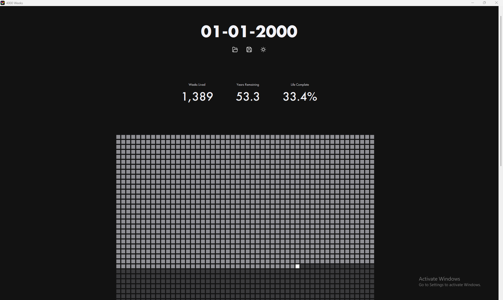
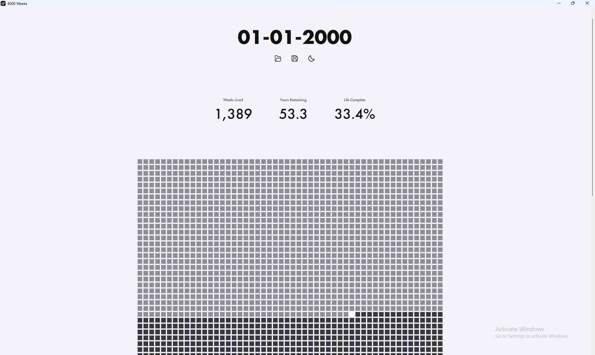
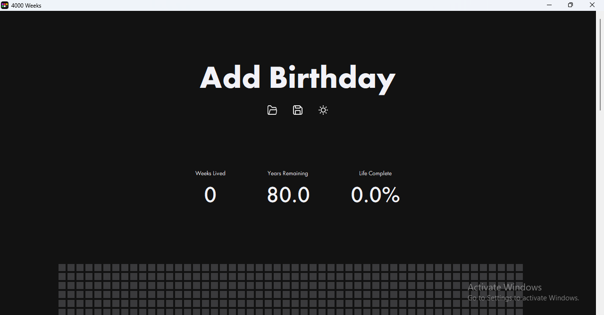
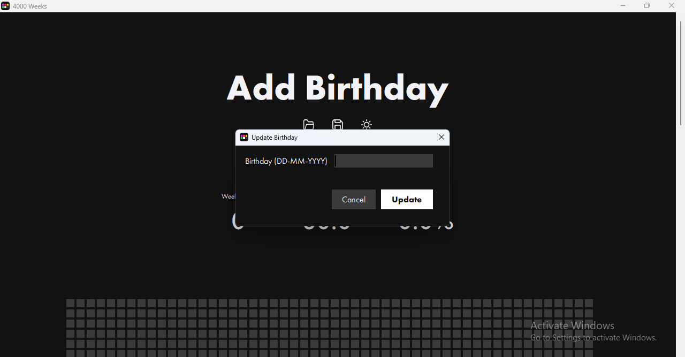
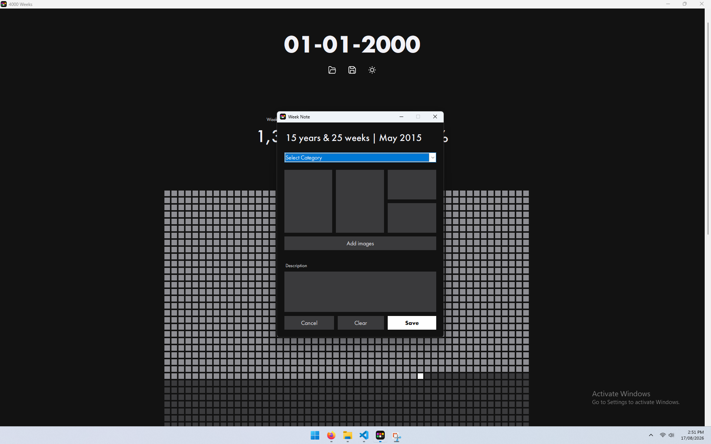

#  4000 Weeks
4000 Weeks is a lightweight app based on Oliver Burkeman's book of the same name which visualises
80 years as a grid of weeks. 
# Overview
## Description
The 4000 Weeks app is your interactive diary for your life. Each time you open the app, your life is represented with all of the weeks you have lived, the present week you are in, and all of your weeks to come. For each week that you have lived, you can add information which will populate the grid with what happened that week: type, up to four images and a text description.

Despite this confronting number of weeks that the average person lives, this app aims to help 
remember your experiences, relive happy memories, and celebrate life.

## Status
Complete

## Tech Stack

**Language:** Python 3.14

**Dependencies:**
- `Pillow` (10.1.0) - Image processing
- `json` (1.1.3) - JSON file reading and writing

**Standard Library:**
- `tkinter` - GUI framework
- `os` - File system operations
- `datetime` - Date handling
- `shutil` - File system operations

## Installation
### Requirements
- Pillow     == 12.3.0

## Features
### Project Tools
- `Open` - Load a locally saved 4000 Week file.
- `Save` - Save the current 4000 Week file.
- `Theme Toggle` - Toggle the UI theme between light mode and dark mode.
- `Update Birthday` - Open a popup to enter a new birthday to visualise 'DD-MM-YYYY'.

### Week Information
- `Week Category` - A list of categories to select from to summarise the events of that week.
- `Images` - Upload 0-4 images per week of the events that happened in that week.
- `Description` - A multi-line text entry to capture the details of the events that week.

## Screenshots
Grid visualisation for 01-01-2000 darkmode.

Grid visualisation for 01-01-2000 lightmode.

Visualisation window with no birthdate.

Add new birthday popup window.

Add data to a week in the grid popup.

## Author
**Kelton Boyter-Grant**  

**AI Disclosure:**  
The use if artificial intelligence (AI) has been used to aid the development of this project. All AI code has been reviewed and approved by a human before integration with the the code base.
